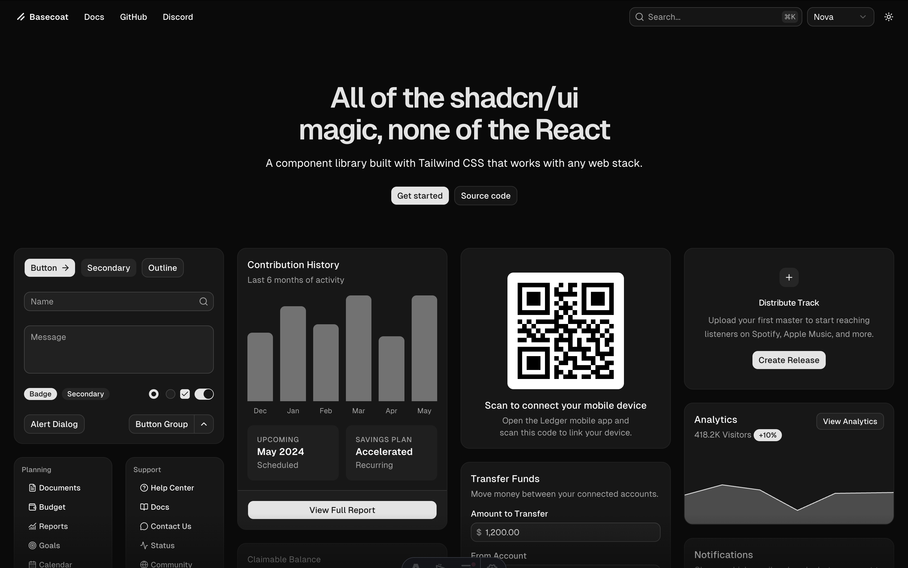

# Basecoat

Basecoat is a Tailwind CSS, vanilla HTML/CSS/JavaScript implementation of the shadcn/ui design system. It provides shadcn-style components for any web stack without React, Radix, or framework runtime dependencies.



## Features

- Semantic HTML-first components.
- Tailwind CSS v4 source files and generated CSS bundles.
- Small vanilla JavaScript for components that need behavior.
- Standalone style packs: Vega, Nova, Maia, Lyra, Mira, Luma, Sera, and Rhea.
- Compatible with shadcn/ui themes.
- Dark mode.
- CDN, npm, and template usage paths.
- Nunjucks and Jinja templates.

## Documentation

- Website: [basecoatui.com](https://basecoatui.com)
- Installation: [basecoatui.com/installation](https://basecoatui.com/installation)
- Customization: [basecoatui.com/customization](https://basecoatui.com/customization)
- Auvyx UI (this fork): [auvyx-ui.vercel.app](https://auvyx-ui.vercel.app), built from `packages/docs`; [llms.txt](https://auvyx-ui.vercel.app/llms.txt)

## Install

```bash
npm install basecoat-css
```

Use the default bundle:

```css
@import "tailwindcss";
@import "basecoat-css";
```

Use a specific style bundle:

```css
@import "tailwindcss";
@import "basecoat-css/nova";
```

Use the styleless base plus a custom style file:

```css
@import "tailwindcss";
@import "basecoat-css/base";
@import "./style-acme.css";
```

## Repository Layout

```text
.
├── dist/                 Generated package output
├── scripts/              Build and generation scripts
├── packages/           Auvyx workspaces: ui, elements, blocks, cli, docs, tests
├── src/                  Package source
│   ├── css/
│   ├── js/
│   └── templates/
└── templates/            Generated package template output
```

## CSS Architecture

Basecoat separates structure from style:

- `src/css/base/base.css`: shared tokens and semantic utilities.
- `src/css/components/*.css`: component layout, structure, accessibility selectors, and behavior hooks.
- `src/css/styles/*.css`: style-pack visuals such as color, radius, shadow, typography, spacing, variants, and state styles.

Generated source entrypoints are committed for transparency and package imports:

- `src/css/basecoat.css`: default backward-compatible Vega bundle.
- `src/css/basecoat-base.css`: base plus components, no style pack.
- `src/css/basecoat-components.css`: component imports only.
- `src/css/basecoat-<style>.css`: base plus one style pack.
- `src/css/basecoat-<style>.cdn.css`: CDN-compatible wrapper.

These entrypoints are generated by `scripts/generate-css-entrypoints.js` and by the build scripts.

## JavaScript Lifecycle

- `window.basecoat.init(name)` initializes uninitialized components for one registered component.
- `window.basecoat.initAll()` initializes all uninitialized registered components.
- `window.basecoat.init(name, { force: true })` and `window.basecoat.initAll({ force: true })` destroy and reinitialize matching components. Use this when a framework or navigation library restores previously initialized DOM from a cache. Force mode resets transient component state such as open menus, focus state, and active interactions.
- `window.basecoat.refresh(element)` asks an initialized component to rescan dynamic children when it supports refresh.
- Components use internal destroy hooks to clean up listeners when initialized roots are removed from the DOM.

## Development

```bash
# Install dependencies.
npm i

# Build package assets.
npm run build

# Build the docs site (packages/docs/out) and serve it.
npm run auvyx:build
python3 -m http.server -d packages/docs/out
```

### Auvyx packages

`packages/*` are npm workspaces: `ui` (CSS, JS, types, `dist/ui/`), `elements` (custom elements), `blocks` (block pages and the registry builder), `cli`, `docs` (the docs site and public registry, `packages/docs/out`) and `tests` (private, the checks). The build needs Python 3 for the block and docs generators.

```bash
# ui -> registry -> docs, as on Vercel.
npm run auvyx:build

# Types, CLI, React blocks against the HTML, split CSS against the bundle,
# ui-deps.json freshness (Chromium via Playwright; about 15 minutes).
npm run auvyx:test

# Only some blocks while working on them.
AUVYX_BLOCKS=login-01,sidebar-07 npm run auvyx:test

# After changing components or their docs examples.
npm run deps -w @auvyx/ui
```

CI runs the same, plus a check that `packages/blocks/*.html` match their generators (`npm run build -w @auvyx/blocks`). Screenshots of failed comparisons are uploaded as the `auvyx-failures` artifact.

## License

[MIT](LICENSE.md)
